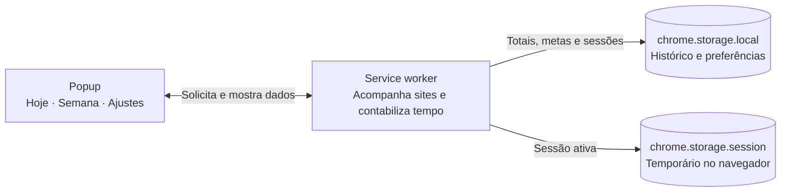

# Doomscroll Tracker

<div align="center">


### Veja para onde vai o tempo que você passa nos feeds.

**Versão 2.4.1**


**[Instalar](#instalação) · [Funcionalidades](#funcionalidades) · [Como funciona](#como-funciona) · [Contribuir](#contribuindo)**

</div>

---

## Por que essa extensão?

Você já abriu o Twitter "só por um segundo" e percebeu que passaram 45 minutos? Isso é **doomscrolling** — o consumo inconsciente e infinito de conteúdo em feeds de redes sociais.

**Doomscroll Tracker** mostra quanto tempo você passa nesses sites, acompanha seu progresso diário e semanal e oferece lembretes gentis para uma pausa. Sem julgamentos, competição ou pressão — só uma visão mais clara do tempo que você escolheu acompanhar.

---

## Funcionalidades

### Um painel claro em três abas

**Aba Hoje**
- **Timer ao vivo** — vê em tempo real quantos minutos você está no site atual
- **Resumo de hoje e da semana** com comparativo vs. ontem e semana passada
- **Sequência de dias** dentro da sua meta e recorde pessoal
- **Mensagens acolhedoras**, sem alarmismo ou culpa, com referência ajustável por você
- **Português e inglês**, com idioma sugerido pelo navegador e opção de troca

**Aba Semana**
- **Gráfico dos últimos 7 dias** com destaque no dia atual
- **Resumo** de média, melhor e pior dia
- **Sites mais acessados** na semana
- **Sessões recentes** com horário de início e duração
- **Exportação CSV** com totais por dia, por site e até 50 sessões recentes

**Aba Configurações**
- **Limite diário ajustável** (10–300 min)
- **Lembretes opcionais** ao chegar a 80% e 100% do limite
- **Lista de sites personalizável** com validação e menu de contexto
- **Resumo semanal opcional**, desativado por padrão
- **Tema claro ou escuro** conforme a preferência do sistema
- **Configuração inicial** com explicação de privacidade

### Privacidade
- **Zero dados enviados** a servidores externos
- Histórico e preferências ficam em `chrome.storage.local`; a sessão ativa usa `chrome.storage.session` e não sai do navegador
- A extensão consulta a aba ativa para verificar se o domínio está na lista escolhida; não coleta páginas fora dela
- Código aberto e auditável

---

## Instalação

> Instalação via modo desenvolvedor — não requer publicação na Chrome Web Store. Requer Chrome 102 ou posterior.

**1. Clone o repositório:**
```bash
git clone https://github.com/TheoGoulart333/doomscroll-tracker.git
```

Ou baixe o ZIP pelo botão **Code → Download ZIP** na página do repositório e extraia a pasta.

**2. Abra o Chrome e acesse:**
```
chrome://extensions/
```

**3. Ative o "Modo de desenvolvedor"** (canto superior direito).

**4. Clique em "Carregar sem compactação"** e selecione a pasta `doomscroll-tracker`.

**5. Pronto!** O ícone aparecerá na barra de ferramentas. Na primeira abertura, escolha o idioma e autorize o acesso aos sites que quer acompanhar. Você também pode continuar sem monitoramento e conceder acesso depois nas configurações. Seus dados permanecem no navegador.

Atualizações preservam configurações e histórico local. O tempo da aba atual também é mantido durante reinícios do processo de fundo do Chrome.

---

## Como funciona

Tudo acontece dentro do Chrome. O popup pede os dados ao service worker; o worker acompanha os sites escolhidos e grava as estatísticas no armazenamento local.



### Fluxo de rastreamento

1. **Troca de aba / mudança de URL** → `background.js` verifica se o domínio está na lista monitorada
2. **Domínio detectado** → inicia timer (`startTimestamp = Date.now()`)
3. **Usuário sai do site** (muda de aba, URL ou fica inativo) → `stopTracking()` calcula `agora - startTimestamp` em minutos
4. **Dados salvos** em `daily`, `weekly`, `siteDaily` (por site/dia) + array de sessões
5. **Streak recalculado** a cada sessão salva
6. **Notificação** disparada ao atingir 80% e 100% do limite diário

### Estrutura dos dados

```json
{
  "daily":     { "2026-11-05": 42, "2026-11-04": 61 },
  "weekly":    { "2026-W44": 180 },
  "siteDaily": { "2026-11-05": { "youtube.com": 20, "reddit.com": 22 } },
  "sessions":  [{ "domain": "youtube.com", "date": "2026-11-05", "start": "14:32", "minutes": 20 }],
  "streak":    3,
  "bestStreak": 7,
  "dailyLimit": 60,
  "trackedDomains": ["youtube.com", "reddit.com", "twitter.com", "..."]
}
```

---

## Sites monitorados (padrão)

| Site | Domínio |
|------|---------|
| YouTube | `youtube.com` |
| Reddit | `reddit.com` |
| Twitter / X | `twitter.com`, `x.com` |
| Instagram | `instagram.com` |
| TikTok | `tiktok.com` |
| Facebook | `facebook.com` |
| Twitch | `twitch.tv` |
| LinkedIn | `linkedin.com` |
| HuffPost | `huffpost.com` |
| BuzzFeed | `buzzfeed.com` |

> Adicione ou remova sites diretamente no popup (aba Configurações → chips clicáveis).

---

## Privacidade

| Item | Detalhe |
|------|---------|
| **Coleta de dados** | Nenhum dado é coletado ou enviado |
| **Armazenamento** | `chrome.storage.local` — exclusivo do navegador do usuário |
| **Telemetria** | Zero — sem analytics, sem tracking externo |
| **Código** | 100% open source e auditável |

**Permissões solicitadas:**
- `storage` — salvar dados localmente
- `activeTab` — acesso temporário à página atual quando você usa a ação da extensão
- `idle` — pausar contagem quando o usuário não está usando o computador
- `notifications` — avisos de limite (desativável nas configurações)
- `alarms` — atualizar o selo e agendar resumos semanais opt-in
- `contextMenus` — adicionar o site atual pelo menu do botão direito
- **Acesso opcional aos sites escolhidos** — solicitado pelo Chrome na configuração inicial ou quando você adiciona domínios. A extensão usa esse acesso para reconhecer as páginas monitoradas; você pode rever ou remover o acesso nas configurações do Chrome.

---

## Estrutura do projeto

```
doomscroll-tracker/
├── manifest.json        # Declaração da extensão (MV3)
├── background.js        # Service worker — coração do rastreamento
├── popup.html           # Interface principal (340px, 3 abas)
├── popup.js             # Lógica do popup: tabs, charts, timer, export
├── options.html         # Página de opções completa
├── options.js           # Lógica das opções
├── icons/
│   ├── icon-16.png
│   ├── icon-32.png
│   ├── icon-48.png
│   └── icon-128.png
├── LICENSE              # MIT
├── CONTRIBUTING.md
└── README.md
```

---

## Contribuindo

Contribuições são muito bem-vindas!

1. **Fork** este repositório
2. Crie uma branch: `git checkout -b feature/minha-feature`
3. Commit seguindo [Conventional Commits](https://www.conventionalcommits.org/pt-br/): `feat: adiciona X`
4. Abra um **Pull Request**

**Ideias abertas:**
- [ ] Mais opções de tema
- [ ] Suporte a Firefox
- [ ] Meta semanal configurável
- [ ] Companion app mobile (Flutter)
- [ ] Publicação na Chrome Web Store

---

## Licença

MIT © 2026 Theo Goulart — Veja [LICENSE](LICENSE) para detalhes.

---

<div align="center">

**Criado para ajudar pessoas a usarem seu tempo online com mais intenção.**

Se este projeto foi útil, considere deixar uma estrela ou compartilhar com alguém.

</div>
